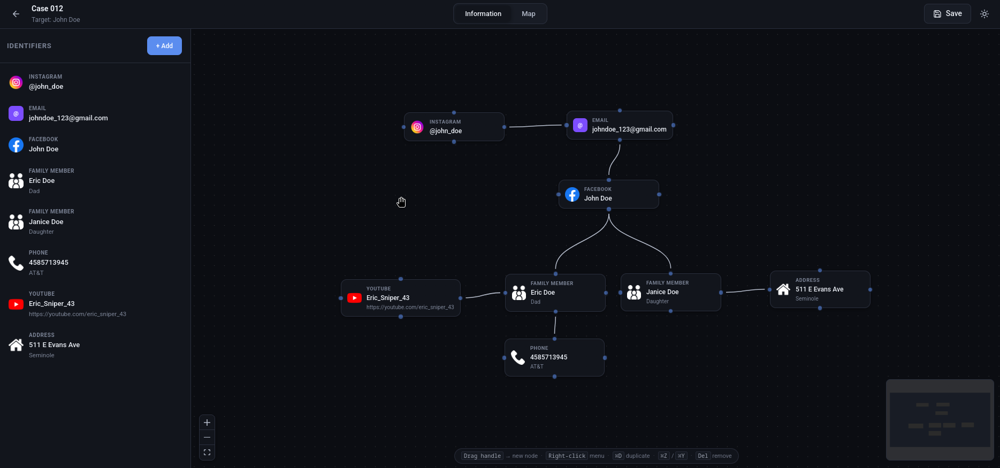
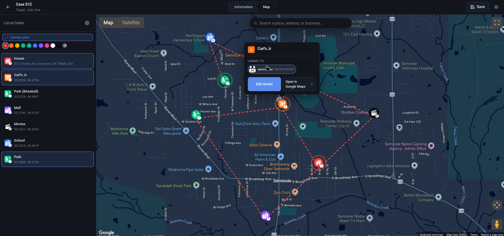

<div align="center">

# OSINT Mapping Tool

A local-first research workspace for organizing OSINT investigations and exploring scholarly sources. Project files and research history stay on your device; research searches are sent to the selected public catalogs.

[](https://react.dev)
[](https://vitejs.dev)
[](LICENSE)
[](#privacy)

</div>

---

## Introduction
### How does the OSINT Mapping tool work?

The **Information tab** is a node graph. Each node is one piece of information: an Instagram account, a phone number, a license plate, a family member. Drag a handle to another node to wire them up. Drop the wire on empty space to spawn a new node already connected (Blender style); right-click does the same thing without dragging. Each type has its own form fields and a brand icon, and you can upload your own icons too.

The **Map tab** is click-to-pin. Drop a pin anywhere, and if the spot is a place the geocoder recognizes (a coffee shop, a school, a park), the name, address, and a fitting icon get filled in for you. There's a search bar for jumping to a place by name. Pins can be linked back to identifiers, so a coffee shop pin can carry "tagged here by @johndoe on March 14" with the relevant Instagram account attached. Pick **Google Maps** (richer POI data, needs an API key) or **OpenStreetMap** (no key, no signup) from the gear icon.

Everything saves out to a single `.osint.json` file you can stash anywhere, share, or version-control.

## Screenshots




<br>

<h2 align="center"> 🛠 Stack </h2>

<div align="center">

|Component |Tool |
|:---|:---|
| UI | React 18, Vite |
| Research API | Node.js built-in HTTP server |
| Scholarly discovery | OpenAlex, Crossref, and Semantic Scholar APIs |
| Node graph | [`@xyflow/react`](https://reactflow.dev) |
| Maps | [`@vis.gl/react-google-maps`](https://visgl.github.io/react-google-maps/), [`leaflet`](https://leafletjs.com) + [`react-leaflet`](https://react-leaflet.js.org) |
| State | React Context (no Redux / no store libs) |
| Storage | Local JSON project files + `localStorage` (settings, custom icons, research history, source collections, and research files) |

</div>

<br>

<h2 align="center"> 🚀 Getting started </h2>

You'll need Node 18+ and npm. The research workspace uses the bundled Node API and public OpenAlex, Crossref, Semantic Scholar, and PeerTube APIs. PeerTube search works without a key. Google Programmable Search, Tavily, Brave Search, and YouTube discovery are optional and require server-side credentials. Keep credentials server-side; do not put them in frontend configuration.

```bash
git clone https://github.com/anonymousRAID/OSINT-Mapping-Tool
cd OSINT-Mapping-Tool
npm install
```

Start the API and frontend together:

```bash
npm run dev
```

Then open <http://localhost:5173>.

Research API requests are proxied to `http://localhost:3001` during development. The `npm run dev` command starts both the API and Vite frontend. For a single-process production run:

```bash
npm run build       # writes the frontend bundle to ./dist
npm run server      # serves the UI and API on port 3001
```

### Deploying to Vercel

Import the repository in Vercel with the project root set to `/` and the **Vite** preset. Use `npm run build` as the build command and `dist` as the output directory. The `api/[...path].js` serverless function hosts the research API on the same domain, so `/api/research`, `/api/research/continue`, `/api/discover/trending`, and `/api/health` work without a separate API host.

Optional provider credentials can be added under the Vercel project's **Settings → Environment Variables** using the server-side names in `.env.example` (for example, `TAVILY_API_KEY` or `YOUTUBE_API_KEY`). Do not use `VITE_` prefixes for server-side secrets. Supabase browser settings use `VITE_SUPABASE_URL` and `VITE_SUPABASE_ANON_KEY`; never add a Supabase service-role key to the frontend. The app can run without optional provider credentials, though some discovery sources will be unavailable.

If visitors should be able to use the deployed site without signing in to Vercel, check **Settings → Deployment Protection** and disable protection for the production deployment.

Optional `OPENALEX_MAILTO` and `CROSSREF_MAILTO` environment variables can provide a contact email to the public catalogs. `SEMANTIC_SCHOLAR_API_KEY`, `GOOGLE_SEARCH_API_KEY`, `GOOGLE_SEARCH_ENGINE_ID`, `TAVILY_API_KEY`, `BRAVE_SEARCH_API_KEY`, and `YOUTUBE_API_KEY` are optional server-side credentials. For Google web results, create a Programmable Search Engine, enable the Custom Search JSON API in Google Cloud, and configure both the API key and search engine ID. Create keys in the respective Tavily and Brave Search dashboards to enable their web results. To enable YouTube, create a Google Cloud API key and enable **YouTube Data API v3** for its project. Configure credentials in your server environment or hosting provider's secret settings. For PowerShell, set them in the terminal before starting the server:

```powershell
$env:TAVILY_API_KEY = "your-tavily-key"
$env:BRAVE_SEARCH_API_KEY = "your-brave-search-key"
$env:GOOGLE_SEARCH_API_KEY = "your-google-search-api-key"
$env:GOOGLE_SEARCH_ENGINE_ID = "your-programmable-search-engine-id"
$env:YOUTUBE_API_KEY = "your-server-side-key"
npm run server
```

For Docker Compose, copy `.env.example` to `.env` and set the provider credentials you use; Compose passes them to the API container. Never commit `.env` or expose server-side provider credentials in frontend configuration. Google Programmable Search returns up to 10 results per query; Tavily and Brave Search each return up to 20 web results per query. PeerTube and YouTube video searches paginate results and return up to 100 videos per configured provider per query.

### Community Research Hub and account profiles (Supabase)

The Community Research Hub and private account profiles use Supabase Auth, Postgres, and private Supabase Storage. Without Supabase configuration, the rest of the application continues to work; account features show sign-in/setup guidance.

1. Create a Supabase project and enable **Email** authentication under Authentication → Providers.
2. Copy the project URL and the **anon/publishable** key (never the service-role key) to `.env` for Docker, or to `.env.local` for local Vite development:

   ```ini
   VITE_SUPABASE_URL=https://your-project.supabase.co
   VITE_SUPABASE_ANON_KEY=your-public-anon-key
   ```

3. Apply the migrations in order: `supabase/migrations/202610170001_community_research_hub.sql`, then `supabase/migrations/202610200001_user_profiles_and_preferences.sql`. The latter adds private per-user profiles and research preferences, RLS-protected private profile photos, and the authenticated `delete_my_account` workflow. Account deletion requires password reauthentication and explicit confirmation.

Research history, saved collections, and mapping projects remain browser-local and are not uploaded or deleted with an account. Preferences stored in the private Supabase profile are used as defaults for future research; an individual research question can still override its purpose and scope. This version supports English only and does not offer notification, summary-detail, or source-type preference controls because those systems are not implemented.
4. Restart the local Vite server or rebuild/restart Docker Compose so Vite loads the public settings. In PowerShell, use `npm.cmd run dev` from this project folder if script execution policy blocks `npm`.
5. Create an account from the Community Hub. Supabase may require email confirmation depending on the project’s Authentication settings.

Research files remain local until the author explicitly publishes one. Publishing copies that saved file’s content and source references to one shared record keyed to the local file ID; later updates reuse that publication. Users can unpublish or remove their own publication, rate it once (and change their rating), or report it. Ratings use a five-rating neutral prior for recommendation scoring to reduce the effect of very small samples. Reports are private to the reporter and moderators; to assign moderators, insert trusted account UUIDs into `public.community_moderators` through the Supabase SQL Editor. Never expose a service-role key in the browser or `.env.example`.

Supabase stores a shared publication copy; it does not synchronize the author’s local file or publish later local edits automatically. Authors should save changes and choose **Update publication** again. Browser-local files, projects, and team-workspace features remain local unless separately integrated with a backend.

### Research Discovery: current scope

The first research workflow validates a question, creates a rule-based outline, searches OpenAlex, Crossref, and Semantic Scholar, optionally searches the web through Google Programmable Search, Tavily, and Brave Search, and separately discovers public videos across PeerTube instances and (when configured) YouTube. Scholarly records are deduplicated by DOI and offer title/abstract search and publication-year filters. Choose a worldwide or specific-region search, plus any publication date or a start/end year range (for example, 2014–2026); a month can optionally be selected when searching a single year. Source count is optional: by default the app retrieves one bounded page from each scholarly catalog; provider-specific limits, throttling, or unavailable catalogs may make results incomplete, and warnings are shown while available records remain accessible. You can cap a search at 20, 50, or 100. Semantic Scholar's search endpoint has a 10,000-result offset limit. Google Programmable Search returns up to 10 results per query; Tavily and Brave Search each return up to 20 web results per query; PeerTube searches public instances including peertube.tv, framatube.org, and tilvids.com without a key, while YouTube requires a server-side API key. PeerTube retries with concise topic terms if the exact question returns no matches. Video searches paginate up to 100 results per instance/provider, with a warning when the provider indicates more are available. Scholarly source cards identify metadata providers and include related publication details, citation counts, and available open-access PDF links when provided. Web result cards are search snippets, not verified facts; open the original page to review its context. Video results are accessible from a dedicated Video discovery tab as well as the combined Source discovery list; cards link directly to the platform and show available channel/date/description metadata. Videos are not downloaded or treated as verified evidence. An abstract or open-access flag is not a claim that the full text was retrieved or read.

The Source discovery view groups results into Government and Official Sources, Academic Research, News and Journalism, Reports and Statistical Data, Websites and Articles, Videos and YouTube, and Books and Other Publications. A group appears only when a returned record matches it; grouping is based on catalog type and URL/publisher heuristics and is not an independent verification of a source. Cards show available provenance, dates, descriptions, original URLs, retrieved evidence, and limitations. To keep the page responsive for large result sets, each source group displays 12 cards at a time with previous/next controls; all matching sources remain accessible. Question relevance is enabled by default and requires matching topic terms in retrieved titles, abstracts, or descriptions; this text-overlap filter is a relevance hint, not a verification of quality or factual support. Users can open originals, save source records to browser storage, compare 2–5 records in a side-by-side table, exclude results from the current discovery view, and launch a similar-source search. Comparisons quote only relevant text found in retrieved abstracts or snippets and mark other details as unreported; they do not infer agreement or disagreement from shared topics. Differences are comparability prompts, not proof that sources conflict, and abstracts/snippets are not full-text review. Saved sources remain in this browser and are not uploaded to a project server.

The **Related topics** tab offers follow-up questions specific to the current research question, explains why each direction matters and how it connects, and names evidence to look for. Selecting a question starts a new search linked to its parent research in browser history. Selecting a recommended source category starts that search with the category filter applied. These are rule-based research prompts, not generated findings; provider searches may not return every recommended source category.

After **Start Research** completes, the workspace switches to a dedicated results screen. Its bottom **HOME** button returns to the prior home/setup screen; **+ New research** opens another search while keeping completed research pages available as tabs at the bottom, so you can switch back without losing the current session. The research workspace sidebar provides **Research Dashboard**, **Research Projects**, **Source Monitoring**, **Evidence & Findings**, **Geographic Explorer**, **Research Briefings**, **Research File Builder**, **Saved Files**, **Team Workspace**, **Source Collections**, **History**, **New Research**, and **Discover** navigation.

The organization dashboard summarizes locally saved projects, current search sources and text excerpts, and saved research files. Project details include objectives, keywords, geography, preferred categories, an owner label, and an active/archived status. Monitoring is manual: this version does not poll providers in the background or send alerts. Publication dates are source metadata, not monitoring/check dates. Evidence excerpts are exact sentences selected from retrieved abstracts and snippets and are not independently verified. The geographic view shows the stated search scope only; it does not infer event locations from text.

The Research File Builder lets users select retrieved sources and exact excerpts from the current search or one/all browser-saved project collections, add a user-provided HTTP(S) link without fetching its page, edit document sections and notes, preview, and save a local file. Each selected excerpt retains a source link, and exported HTML includes a source list. The print-ready view can be printed or saved as PDF through the browser. DOCX, XLSX, and PPTX generation is not configured. Saved files can be reopened, duplicated, renamed by editing, and revised; prior saved versions are retained in the file record. Files and projects use this browser's local storage and are not synchronized or shared. Team roles, comments, accounts, and collaborative workspaces need a server-side authentication and storage service that this project does not currently provide.

History is stored locally in this browser. Discover combines current Google Trends RSS items with related headline snippets and YouTube's `mostPopular` video chart when the server has `YOUTUBE_API_KEY`; YouTube cards link to the original video and show provider thumbnails and available metadata. The Google Trends feed can select its own region, which the page reports rather than describing the feed as worldwide. The YouTube chart request has no region code and is labeled region-unspecified. Article snippets and search traffic can provide context but do not verify why a topic is trending; the YouTube API does not return a separate explanation. Results are cached in the API process for up to 10 minutes, and a provider warning is shown if only one source is available.

Research result lists also render in batches of 50. Browser history keeps a compact snapshot of up to 50 scholarly records and 20 records for each web/video category, truncating long abstracts/descriptions; the active research session retains the complete retrieved results. History entries indicate when their saved copy is partial.

Source discovery includes a collapsible filter drawer for multi-select source categories, publication-date presets and custom ranges, sort order, geography text mentions, available organization/evidence signals, accessibility indicators, research-area and question matching, exact claim text, and include/exclude phrases. Filters operate on the retrieved result set locally and do not launch another search. A year-only catalog date is matched at year precision; retrieval time is never substituted for a publication date. Geography searches inspect titles, abstracts, and descriptions, not publisher location, and only establish a text mention rather than geographic relevance. Organization and evidence classifications are conservative signals from metadata/content and are unavailable where those signals are absent. Active filters appear as removable chips; **Clear All** resets filters and current-view exclusions. Matching results remain limited to what providers returned.

The **Claims and evidence** view selects one question-relevant exact sentence per source from retrieved abstracts, search snippets, and video descriptions by matching wording with the research question. Each statement links to its source, shows the retrieved passage context, available publication date, author/publisher, retrieval location, and limitations. Identical sentences from multiple sources are grouped, and results are paginated. These are source-reported statements, not platform-verified facts; a direct text match establishes only that the retrieved text contains the wording. The view does not infer indirect support, interpretations, or contradictions, and explicitly states that conflicting evidence has not been assessed automatically. It does not generate AI synthesis, uncertain conclusions, or unsupported factual claims. Sources without relevant retrieved text do not produce evidence statements.

Web descriptions are provider snippets, not verified facts, and videos are represented by public metadata only. The interface labels source relevance as an unverified text-overlap hint, marks unavailable fields, and does not claim to have fetched or read full text. Official-source/news/report categories are heuristic classifications, not dedicated or exhaustive searches of every government, court, legislation, company-filing, news, or statistical repository; those categories appear only when a result is returned and classified. There is no AI model configured in this release: the question outline is explicitly labeled rule-based, and the app does not invent claims, evidence, quotations, or summaries. Treat suggested research areas as prompts, not findings. A search with no results is not evidence that no research exists.

OpenAlex, Crossref, Semantic Scholar, and PeerTube are queried as public metadata/search services; response availability, quotas, and coverage depend on each provider. Optional Google Programmable Search, Tavily, Brave Search, and YouTube integrations require server-side credentials and may have changing prices, quotas, and terms. Check each provider's current documentation and terms before deployment or high-volume use. Crossref documents its public REST API and metadata reuse at <https://www.crossref.org/documentation/retrieve-metadata/rest-api/>. Keep all credentials server-side; do not send them to the browser or commit them to the repository.

The current integration choices favor searchable public catalogs for scholarly metadata, a public PeerTube instance for no-key video metadata, and optional general-web/video providers only when an operator configures credentials. They are not a guarantee of provider uptime or comprehensive coverage. Google Programmable Search, Tavily, Brave Search, and YouTube are subject to provider quotas, plans, and terms. Review current [Google Custom Search JSON API documentation](https://developers.google.com/custom-search/v1/overview), [Tavily API documentation](https://docs.tavily.com/documentation/api-reference/endpoint/search), [Brave Search documentation](https://api.search.brave.com/app/documentation/web-search/get-started), [YouTube Data API quota guidance](https://developers.google.com/youtube/v3/determine_quota_cost), and each provider's terms before enabling them. The app limits web and video results per provider, does not crawl the original pages, and does not re-publish provider snippets as verified evidence.

Guest research history and the optional landing-screen display name are stored in this browser's `localStorage`; there are no user accounts or server-side project records. The landing screen uses the saved name for a local-time greeting, and the name can be changed there. To remove local research history and the name, clear this site's browser storage. The original OSINT mapping projects remain local `.osint.json` files.

<br>

## Setting up Google Maps (optional)

You only need this if you want Google Maps mode. If you'd rather skip Google Cloud entirely, jump to [OpenStreetMap mode](#openstreetmap-mode). Your key lives only in your browser and never gets committed or sent anywhere else.

In Google Cloud Console, pick or create a project and:

1. Under **APIs & Services → Library**, enable **Maps JavaScript API**, **Geocoding API**, and **Places API**. Maps JS is required; the other two power address auto-fill and place-type detection.
2. Under **APIs & Services → Credentials**, make an API key.
3. On that key, set **Application restrictions → HTTP referrers** and add `http://localhost:5173/*` for development. This is the only thing keeping the key safe if it ever leaks.
4. Optional: create a **Map ID** under Maps Management → Map Styles for custom styling. Without one you'll see a console warning but the app still works.

Two ways to feed the key to the app:

**In-app:** Paste it into the Map tab's setup screen and click Save. It goes into `localStorage`. If you already proceeded without one, the gear icon at the top left opens the same settings.

**Config file:** Copy the template:

```bash
cp public/app.config.example.json public/app.config.json
```

Then fill in your values:

```json
{
  "googleMaps": {
    "apiKey": "AIzaSyD…",
    "mapId": "abc123def456…"
  }
}
```

`public/app.config.json` is gitignored, so even if you push commits it won't leak.

If both are set, `localStorage` wins. Clear it from the gear icon to fall back to the file.

## OpenStreetMap mode

Don't feel like dealing with Google Cloud? Open the Map tab's settings (gear icon) and switch the provider to **OpenStreetMap**. Tiles come from openstreetmap.org and search/reverse-geocoding runs through Nominatim. No key, no signup, and your viewport survives switching tabs. POI detection is coarser than Google's, and the per-pin info card doesn't have live place details (rating, hours, etc.) — everything else works the same.

## Saving, opening, and the "Continue recent" list

Click **Save** in the top-right and the project downloads as `<name>.osint.json`. Click **Open Project** on the landing screen to read one back. The format is plain JSON with a schema version, so old files keep loading after upgrades.

While you're working, the app also takes a periodic snapshot to `localStorage`. If you accidentally hit the back arrow without saving (this has happened to me more than once), the project shows up under "Continue recent" on the landing screen with an "unsaved" badge. Pick it and you're back where you were. Up to 5 recent projects are kept per browser.

`.osint.json` is gitignored too, so dropping one in the repo folder won't end up in commits.

## Running with Docker

If you'd rather not install Node.js locally, you can run the development environment with Docker Compose.

### Requirements

- Docker
- Docker Compose

Clone the repository and create a `.env` file in the project root:

```bash
cp .env.example .env
```

Fill in your Google Maps credentials (only required if you want to use Google Maps mode):

```ini
GOOGLE_MAPS_API_KEY=AIzaSy...
GOOGLE_MAPS_MAP_ID=abc123def456
```

If you only intend to use **OpenStreetMap** mode, these values can be left blank.

Then start the app and its research API containers:

```bash
docker compose up --build
```

Once the container has started, open:

<http://localhost:5173>

Compose starts the Vite frontend and the research API together; the frontend proxies `/api` requests to the API container. The application automatically generates `public/app.config.json` from the values in `.env`, so your Google Maps API key never needs to be committed to the repository. If `.env` has no values, the frontend container logs a notice and leaves any existing `public/app.config.json` alone.

Changed `.env` after the container was created? Run `docker compose up` again (not `docker compose start`) — the environment is baked in when the container is created, so it has to be recreated to pick up new values. Compose does this automatically on `up` when it sees the change.

To stop the container:

```bash
docker compose down
```

## Features in depth

### Information tab

Twenty built-in identifier types across Social, Contact, Personal, Vehicle, and Other, each with its own typed fields (Instagram: username, followers, posts, bio; Vehicle: make, model, year, color, owner; etc.).

Connections:
- Drag a handle from one node to another to wire them up.
- Drag to empty space to get a quick-add popup (this also auto-creates the wire to the new node).
- Right-click the canvas for the same popup without the wire.

Icons:
- Brand icons for common platforms (Instagram, Facebook, X/Twitter, YouTube, TikTok, LinkedIn, Snapchat, Discord, Telegram, Google, Spotify, WhatsApp).
- Upload your own. They get stored per-browser, so they're available across all projects on the same install.

Editing shortcuts (suppressed when you're typing in a field or a modal is open):
- `Ctrl/Cmd + Z` undo, `Ctrl/Cmd + Shift + Z` or `Ctrl/Cmd + Y` redo. Up to 20 actions, kept in memory.
- `Ctrl/Cmd + C / V` to copy/paste selected nodes.
- `Ctrl/Cmd + D` to duplicate.
- `Del` or `Backspace` removes the selection (a node or an edge).

Multi-select with a marquee or `Shift+click`. Anything done to a multi-selection counts as one undo step.

### Map tab

Click anywhere to drop a pin. If the spot is a known place — a Google POI in Google mode, a Nominatim hit in OSM mode — the name, address, and a fitting icon get filled in. Otherwise you get coordinates and fill the rest in.

Ten built-in place icons (coffee, food, gym, home, movie, park, amusement park, school, shopping, clothes, library) with light and dark variants that swap with the theme. The icon and color are overridable per-pin.

Clicking a pin opens a card with your notes (visited date, who they were with, free-form notes), the identifiers linked to it, and a link out to the live map. In Google mode the card also shows whatever place details Google has on file (rating, opening hours, phone, website).

A "Connect pins" toggle in the sidebar draws a dashed line between pins in the order they were dropped. Line color is customizable.

### Cross-linking the two tabs

Pins can be linked to one or more identifiers, each link with a short note ("checked in on IG", "registered owner", "previous address"). Click an identifier chip in a pin's card to jump to the Info tab with that node highlighted. Hover an identifier in the Info-tab sidebar and the pins linked to it pulse on the map.

## Project layout

```
src/
  components/                 UI components (tabs, modals, pickers)
    ResearchDiscovery.jsx     Research question, map outline, sources, and filters
  context/                    ProjectContext, NodeHistoryContext, NavigationContext, …
  images/
    icons/                    place-type pin icons (light + dark)
    node_icons/               brand icons for identifiers
  styles/                     global + theme CSS
  utils/                      projectIO, customIcons, appConfig, recentProjects
  identifierTypes.js          identifier type registry + resolvers
  identifierIcons.js          identifier brand-icon registry
  mapIcons.js                 place-type icon registry + Google-types mapping
  pinColors.js                pin color palette
  App.jsx                     landing ↔ project view gate
  main.jsx                    provider stack + root render
server/
  index.js                    validation, rate limiting, catalog API, static serving
  research.js                 question planning and source normalization
tests/
  research.test.js            API and normalization tests
public/
  app.config.example.json     template for your API key (committed)
  app.config.json             your real key (gitignored)
```

## Privacy

The mapping-only workflow has no server-side project storage or analytics. Research questions are sent from the local Node API to OpenAlex, Crossref, and Semantic Scholar to retrieve scholarly records. Google Maps and OpenStreetMap modes make requests to their respective map/search services.

Your settings and custom icon library live in `localStorage` on this browser. Project files (`*.osint.json`) live on whatever disk you saved them to. To wipe everything, clear site data for the origin you're running on and delete the `.osint.json` files.

The repo's `.gitignore` keeps `app.config.json` and `*.osint.json` out of commits, so accidentally working inside the cloned folder won't leak your key or your research.

## License

[GPL-3.0](LICENSE).

## Contributing

PRs welcome. Do not add analytics, remote sync, or third-party tracking. Be explicit in the interface and documentation whenever a feature sends a user's research question or other data to an external provider.

<br>
<div text-align="left">
  <p>
    
    &nbsp;&nbsp;&nbsp;0x59bFD011AaAeA85AF644A574a11836673CAcfCD4
  </p>
  <p>
    
    &nbsp;&nbsp;LYxKNT7TAWZAM96Vz2HRxyUmvZbqEqiofe
  </p>
</div>
